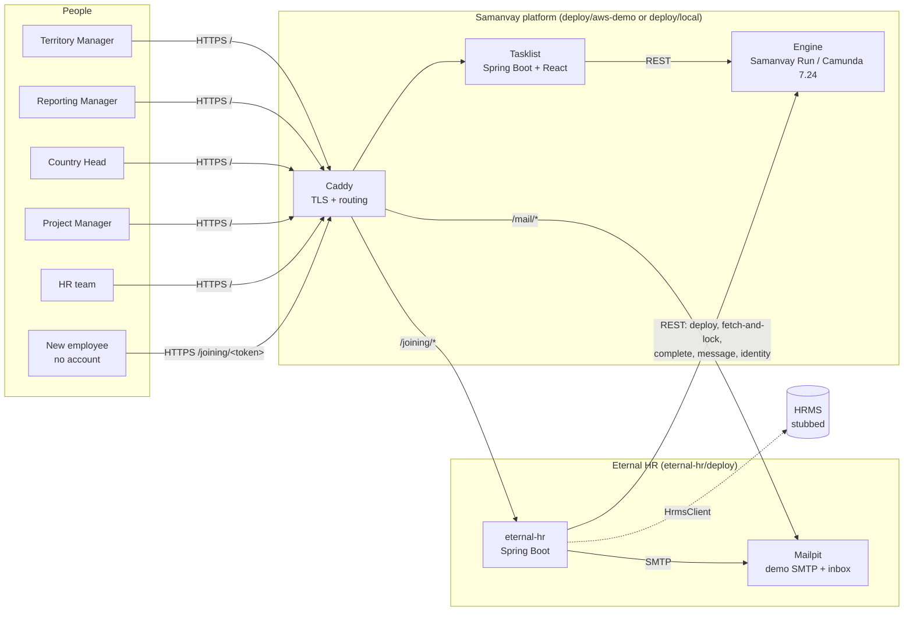
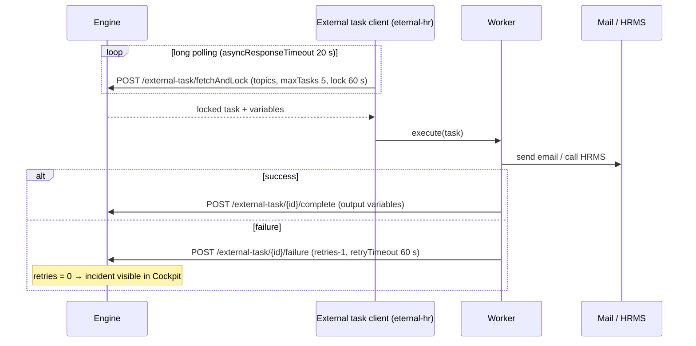
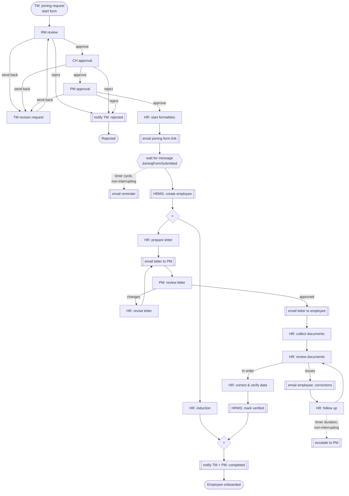
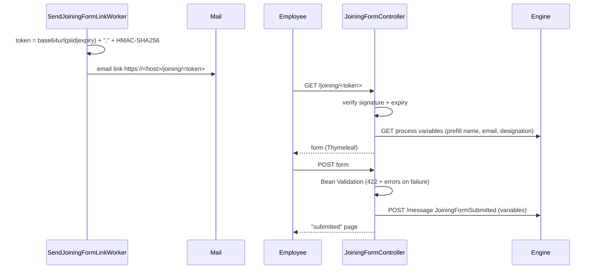
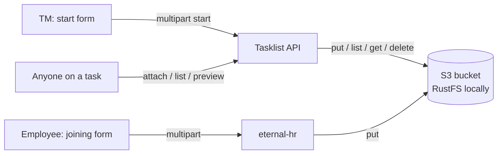
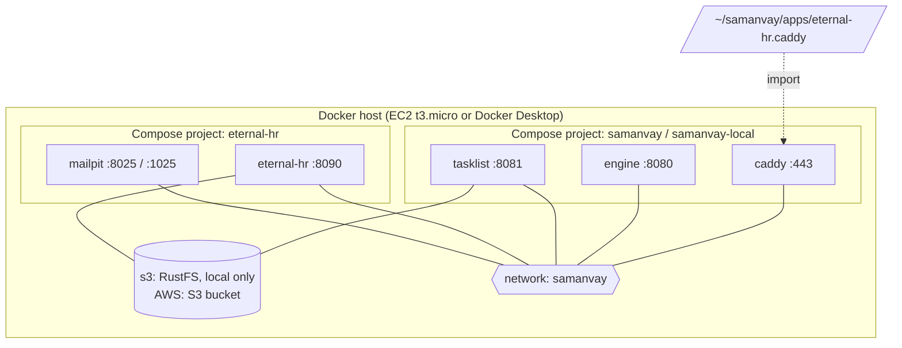

# Eternal HR: technical architecture

Eternal HR automates the **joining and documentation workflow** from
`design/Joining & Documentation Workflow Process.pptx` on the Samanvay BPM Platform (a Camunda 7.24 distribution).
This document covers how the application is built, how it connects to the platform, and how it is deployed. For
the business process in brief and the run commands, see [README.md](README.md).

## 1. Design principles

| Principle | What it means here |
| --- | --- |
| **Process application, not a platform fork** | All Eternal HR logic lives in `eternal-hr/`. The platform has only generic features, such as starting processes, forms shipped in a deployment, and branding, which any other process app can use. |
| **External task pattern** | The engine never runs Eternal HR code. Every automated step is a BPMN service task with `camunda:type="external"`, which a worker in this app fetches and completes over REST. |
| **REST only** | The app talks to the engine only through `/engine-rest`. There is no shared JVM, classpath or database. The engine and the app can be restarted, scaled and upgraded independently. |
| **Self-deploying** | On startup the app deploys its own BPMN and forms as a single deployment, so the process and its workers always ship together. |
| **Independently deployable** | Its own Maven build, jar, Docker image, Compose project and deploy script. Deploying it never redeploys the platform. |

## 2. System context



| Component | Technology | Owns |
| --- | --- | --- |
| **Caddy** (platform) | Caddy 2 | TLS (Let's Encrypt on AWS, internal CA locally) and routing. It imports `apps/*.caddy`, which is how Eternal HR adds its routes. |
| **Engine** (platform) | Samanvay Run (Camunda 7.24), H2 | Process state, timers, user tasks, identity (users and groups), history, Cockpit and Admin at `/camunda/`. |
| **Tasklist** (platform) | Spring Boot 3 + React/MUI | The UI where people start the process and complete their user tasks. It renders JSON Schema forms. It is branded through `TASKLIST_BRAND_*`. |
| **eternal-hr** (this app) | Spring Boot 3.5, Java 17 | External task workers, process and form deployment, demo user seeding, the public joining form, and email. |
| **Mailpit** (this app, demo only) | `axllent/mailpit` | Catches all outgoing email and shows it at `/mail/`, password protected. In production it is replaced by a real SMTP server. |

All containers share the Docker network `samanvay`. The platform's Compose file creates it, and Eternal HR's Compose
file joins it as `external`. Only Caddy publishes ports.

## 3. The eternal-hr application

### 3.1 Package layout

```
com.eternalhr.onboarding
├── EternalHrApplication          Spring Boot entry point
├── config/
│   ├── EternalHrProperties       typed, validated settings (prefix eternal-hr)
│   └── ClockConfig               injectable Clock (tests control time)
├── engine/
│   ├── EngineClient              REST client for /engine-rest (RestClient + Basic auth)
│   └── EngineBootstrap           deploys processes, seeds demo users; retries until the engine is up
├── workers/
│   ├── Worker                    base class: complete / handleFailure with retries
│   ├── Recipients                resolves people in the process to email addresses
│   └── *Worker (10)              one per external task topic
├── joining/
│   ├── JoiningFormLinks          HMAC-signed, expiring form links
│   ├── JoiningForm               form model + Bean Validation rules
│   ├── JoiningFormService        prefill from process variables; submit = message correlation
│   └── JoiningFormController     GET/POST /joining/{token} (Thymeleaf), with document uploads
├── documents/
│   ├── EmployeeDocuments         checks the employee's files and types, stores them all or none
│   ├── S3DocumentStore           writes to the platform's bucket in the tasklist's layout
│   └── FileCheck                 PDF/JPEG/PNG by content, safe file names
├── notify/
│   └── Mailer                    renders templates/mail/*.html, sends with JavaMailSender
└── hrms/
    ├── HrmsClient                interface to the HR management system
    └── StubHrmsClient            default implementation (issues EHR-yyMM-nnnnn codes)
```

Resources:

```
src/main/resources/
├── application.yml
├── processes/                         deployed to the engine as one deployment named "eternal-hr"
│   ├── eternal-hr-joining.bpmn
│   ├── document-types.json            document types; "employee": true ones are offered on the joining form
│   └── forms/*.form.json              14 JSON Schema task forms
└── templates/
    ├── joining/                       public joining form pages (layout, form, submitted, unavailable)
    └── mail/                          email layout + 7 email templates + letter-details fragment
```

### 3.2 Dependencies

- `spring-boot-starter-parent` 3.5.5, with `camunda-bom` 7.24.0 importing versions.
- `camunda-bpm-spring-boot-starter-external-task-client`: the external task client, which subscribes workers with
  `@ExternalTaskSubscription`.
- `spring-boot-starter-web`, `-thymeleaf`, `-validation`, `-mail` and `-actuator`.
- `jakarta.xml.bind-api` and `jaxb-runtime`. The external task client needs these at runtime, and they are no longer
  part of the JDK.
- Test only: `camunda-bpm-spring-boot-starter-test` / engine, `camunda-bpm-assert`, Spin, H2 and JUnit 5.

## 4. Integration with the engine

### 4.1 External task pattern



Client settings (`camunda.bpm.client.*` in `application.yml`): worker id `eternal-hr`, `async-response-timeout`
20 s, `lock-duration` 60 s, `max-tasks` 5, and Basic auth with the engine service account.

**Failure handling.** `Worker` (the base class) catches any `RuntimeException` from `work()` and reports it with
`handleFailure`. A task gets 3 attempts, one minute apart. After that the engine raises an **incident**. An operator
fixes the cause, for example a missing email address, and clicks *Retry* in Cockpit. Workers are written to be
safe to repeat. HRMS creation is guarded so that a retry does not create a second record. An email may be sent twice
if the complete call itself fails, which is acceptable for notifications.

### 4.2 Topics

| Topic | Worker | Does | Sets variables |
| --- | --- | --- | --- |
| `ehr.notify.joining-rejected` | `JoiningRejectedWorker` | Emails the initiating TM that the joining was rejected, with the stage and reason | `rejectedBy` |
| `ehr.joining-form.send-link` | `SendJoiningFormLinkWorker` | Creates a signed link and emails it to the candidate | `joiningFormLink`, `joiningFormLinkExpiresAt`, `joiningFormReminderCycle` |
| `ehr.joining-form.send-reminder` | `JoiningFormReminderWorker` | Emails the candidate a reminder with a fresh link | `joiningFormLink`, `joiningFormLinkExpiresAt` |
| `ehr.hrms.create-employee` | `HrmsCreateEmployeeWorker` | Creates the employee in HRMS; on a retry, reuses an existing `employeeCode` instead of creating a second record | `employeeCode`, `hrmsRecordCreatedAt` |
| `ehr.letter.send-for-approval` | `LetterForApprovalWorker` | Emails the letter details to the approving PM | none |
| `ehr.letter.send-to-employee` | `LetterToEmployeeWorker` | Emails the approved appointment letter to the employee | `appointmentLetterSentAt` |
| `ehr.documents.request-correction` | `DocumentCorrectionWorker` | Emails the employee the document issues HR found, and sets the escalation timer value | `documentCorrectionRequestedAt`, `documentEscalationAfter` |
| `ehr.documents.escalate` | `DocumentEscalationWorker` | Emails the PM, copying HR and the TM, that documents are still missing | `documentsEscalatedAt` |
| `ehr.hrms.mark-verified` | `HrmsMarkVerifiedWorker` | Marks the HRMS record verified | `hrmsVerifiedAt` |
| `ehr.notify.joining-completed` | `JoiningCompletedWorker` | Emails the TM and PM that onboarding is complete, with the employee code | `joiningCompletedAt` |

`Recipients` resolves people to addresses at send time: the candidate from `candidateEmail`, the TM from
`initiator`, the PM from `projectManager` and HR from the members of `hr-team`. All of these come from the
engine's identity service (`/user/{id}/profile`, `/user?memberOfGroup=`).

### 4.3 REST calls made by `EngineClient`

| Call | Purpose |
| --- | --- |
| `POST /deployment/create` (`enable-duplicate-filtering=true`, `deploy-changed-only=false`) | Deploy the BPMN and forms on startup. Unchanged resources produce no new version. Any change produces a new version of everything, so a process version and its forms always match. |
| `GET /process-instance/{id}/variables` | Prefill the joining form and check that the joining is still running. |
| `POST /message` (`JoiningFormSubmitted`, `processInstanceId`) | Hand the employee's form to the waiting receive task. A 400 or 404 means nothing is waiting (already submitted, or ended), which shows as "link no longer valid". |
| `GET /user/{id}/profile`, `GET /user?memberOfGroup=` | Look up email addresses. |
| `GET/POST /group…`, `/user/create`, `PUT /group/{g}/members/{u}` | Seed demo groups and users (demo mode only). |

The service account needs to deploy, read and correlate process instances, read users and groups, and work on
external tasks. On the demo it is the platform `admin`.

### 4.4 Startup (`EngineBootstrap`)

On `ApplicationReadyEvent` a background thread deploys `classpath*:processes/**`. If
`eternal-hr.demo.seed-users=true`, it then creates the five role groups and one demo user per role. It retries
every 15 s until it succeeds, so the app can start before the engine and its health check is not blocked by the
engine.

## 5. The process: `eternal-hr-joining`

`Employee joining & documentation`, version tag `1.0`, `candidateStarterGroups="territory-managers"`, history time
to live P180D. It has one pool with six lanes: Territory Manager, Reporting Manager, Country Head, Project Manager,
HR Team and Eternal HR system.



`[[ ]]` = external service task, `{{ }}` = receive task.

**Key modelling decisions**

- **Approvals.** The three approval tasks go to candidate groups. A `complete` task listener records who approved
  (`reportingManager`, `countryHead`, `projectManager`). The letter review is then assigned to
  `${projectManager}`, the same PM who approved the joining. The revision task goes back to `${initiator}`, the TM
  who started it.
- **Send back and reject.** Each approval sets `<role>Decision`. A shared gateway routes send-back to the TM and
  reject to a notification. When the request is revised, a listener removes the earlier decisions so they can't
  leak into the next round.
- **Employee step.** A receive task waits for the `JoiningFormSubmitted` message, correlated by process instance id.
  A **non-interrupting timer cycle** (`${joiningFormReminderCycle}`, R3/P2D by default) sends up to three reminders.
  The cycle comes from a process variable that the send-link worker sets, so the timing is configured in the app,
  not in the BPMN.
- **Parallel work.** After the HRMS record is created, induction runs in parallel with the letter → documents →
  verification branch. A parallel join waits for both before the completion notification.
- **Document follow-up.** A **non-interrupting timer duration** (`${documentEscalationAfter}`, P3D by default, set by the correction worker) on
  *Follow up on documents* emails the PM once while HR keeps following up.

**Demo timings.** The Compose file sets the reminder cycle to `R3/PT10M` and escalation to `PT15M`, so both show up
during a demo.

## 6. Forms

### 6.1 Task and start forms (tasklist)

The 14 forms are JSON Schema files referenced as
`camunda:formKey="samanvay:deployment:forms/<name>.form.json"`. They are deployed **in the same deployment** as the
BPMN, so every process version carries its own forms.

How the tasklist resolves them (platform feature, `samanvay-tasklist` `form/`):

1. `FormResolver` sees the `samanvay:deployment:` prefix on a task's or the start event's form key.
2. `DeploymentForms` looks up the process definition's `deploymentId`, then loads the resource through
   `GET /deployment/{id}/resources` and `.../resources/{rid}/data`. The result is cached per deployment, since
   deployments are immutable.
3. The schema is returned to the React UI, which renders and validates it. `FormSubmissions` validates and converts
   the submitted values on the server before completing the task.

**Starting a process** (platform feature, `samanvay-tasklist` `process/`): `GET /api/processes` lists the latest
active definitions the user may start (`startableBy`). `GET /api/processes/{key}/start-form` returns the start form,
and `POST /api/processes/{key}/start` starts the process. The server sets `initiator` and `initiatorName` **after**
the form values, so a form can't fake who started it.

### 6.2 Public joining form (eternal-hr)

New employees have no tasklist account, so eternal-hr serves their form itself at `/joining/{token}`.



- **Tokens** are stateless: `base64url(processInstanceId|expiryEpoch).base64url(HMAC-SHA256(secret, payload))`.
  The signature is compared in constant time (`MessageDigest.isEqual`). Links are valid for 14 days by default
  (`ETERNAL_HR_LINK_VALIDITY`). The secret must be at least 32 characters, or the app refuses to start.
- **Single use** comes from the process, not the token. Once the message has been correlated, nothing is waiting
  for it, so a second submission is refused.
- **Every invalid case** (bad signature, expired, unknown or finished instance) returns the same **404**
  "link unavailable" page. This avoids leaking which tokens or instances exist. Validation errors return **422**
  with the form and its messages.
- **Normalisation:** inputs are trimmed, and PAN and IFSC are uppercased before validation.

## 7. Documents

Documents (PDF, JPEG, PNG) can be attached to a joining at every step. They are stored in **S3**. Locally, a
RustFS container stands in for S3 (MinIO no longer publishes images).



**Where they live.** One object per document, in the platform's bucket:

```
process-instances/{processInstanceId}/documents/{documentId}
  Content-Type: application/pdf | image/jpeg | image/png
  x-amz-meta-document-type, -document-type-label, -file-name, -uploaded-by, -uploaded-by-name,
  -uploaded-at (ISO-8601), -step                       (values URL-encoded; S3 metadata is ASCII)
```

This layout is the contract between the tasklist (`samanvay-tasklist` `document/S3DocumentStore`) and process
apps (`eternal-hr` `documents/S3DocumentStore`, which only writes). Nothing else records documents: listing a
process's documents lists its prefix.

**Document types** come from `processes/document-types.json`, deployed with the BPMN. The tasklist reads it from the
process's deployment and offers every type. The employee form offers only the types marked `"employee": true`, so
"Appointment letter" is only for HR.

**Who can do what** (tasklist):

| Action | Allowed when |
| --- | --- |
| See the documents and preview them | The user can see a task of the process (assignee or candidate). Every step therefore shows everything attached so far. |
| Attach | The task is assigned to the user, the same rule as completing it |
| Remove | The user attached the document and is working on the task. Nobody can remove anyone else's, including the employee's. |
| Attach when starting | Part of the start request. Files are checked before the process starts. If they cannot be stored, the new instance is deleted again. |

The employee attaches documents on the public joining form. The signed link is the credential. They are stored
before the form is handed to the process, and removed again if the form is refused (for example, already submitted).

**Checks.** Files are recognised by their first bytes (`%PDF-`, JPEG and PNG signatures), never by name or the type the
browser claims. Nothing else is accepted, so no HTML or SVG can be stored and later shown. The limit is 10 MB per file
and 10 files per request. File names are reduced to a safe display name. Content is served with the verified type,
`Content-Disposition: inline`, `nosniff` and `no-store`.

**Preview.** On a task or start form, clicking a document opens it in a pane **beside the form**. The pane stays in
view while the form scrolls, so a reviewer can check the document against the data. PDFs use the browser's viewer
and images can be zoomed. On phones the preview opens full screen. The file is fetched with the user's session and
shown from a `blob:` URL, so it never needs a public link.

**Configuration.**

| Tasklist (platform `.env`) | eternal-hr (`.env`) | Purpose |
| --- | --- | --- |
| `DOCUMENTS_BUCKET` → `SAMANVAY_DOCUMENTS_BUCKET` | `DOCUMENTS_BUCKET` → `ETERNAL_HR_DOCUMENTS_BUCKET` | Bucket; empty turns documents off |
| `DOCUMENTS_REGION` | `DOCUMENTS_REGION` | AWS region (default `ap-south-1`) |
| `DOCUMENTS_ENDPOINT` | `DOCUMENTS_ENDPOINT` | S3-compatible store (local: `http://s3:9000`); empty for AWS |
| `DOCUMENTS_ACCESS_KEY` / `_SECRET_KEY` | same | Local only. Empty uses the default AWS credentials (EC2 instance role) |
| `DOCUMENTS_CREATE_BUCKET` | same | Create the bucket if missing (local) |

Locally, `deploy/local/up.sh` generates these settings, and `up-local.sh` copies them to Eternal HR. The RustFS console is at
http://127.0.0.1:19001/rustfs/console/.

## 8. Notifications

`Mailer` renders `templates/mail/<name>.html` inside `layout.html` with Thymeleaf. The letter details are a shared
fragment. Emails are HTML and contain links to the tasklist (`ETERNAL_HR_TASKLIST_URL`) or the joining form. The
sender and HR mailbox are configurable (`ETERNAL_HR_MAIL_FROM`, `ETERNAL_HR_HR_EMAIL`).

In the demo, SMTP goes to Mailpit (`mailpit:1025`), so every email can be read at `/mail/`. For production, set
`ETERNAL_HR_SMTP_HOST/PORT/USERNAME/PASSWORD/AUTH/STARTTLS` to the real relay and remove Mailpit.

## 9. HRMS integration

`HrmsClient` is the boundary to the HR management system (`createEmployee(details)` returns the employee code, `markVerified(code)`). The default
`StubHrmsClient` issues `EHR-yyMM-nnnnn` codes and logs the calls. To integrate a real HRMS, add an `HrmsClient`
bean that calls its API. Workers and the process stay the same, and HRMS failures automatically become
retries and then incidents.

## 10. Identity, roles and access

| Group (engine) | Demo user | Used for |
| --- | --- | --- |
| `territory-managers` | `tm.demo` | May start the process; receives send-backs; notified on reject and complete |
| `reporting-managers` | `rm.demo` | RM review |
| `country-heads` | `ch.demo` | CH approval |
| `project-managers` | `pm.demo` | PM approval and letter review; notified on escalation and complete |
| `hr-team` | `hr.demo` | All HR tasks; email recipients for HR notifications |

- Users sign in to the tasklist with engine identities. Who may start the process comes from `candidateStarterGroups`,
  and who sees a task comes from candidate groups or the assignee.
- Group ids contain `-`. The platform engine's `general-resource-whitelist-pattern` was widened to
  `[a-zA-Z0-9][a-zA-Z0-9._@-]*` (`deploy/aws-demo/engine/default.yml`) to allow this.
- **Exposure:** only `/joining/*` (signed tokens) and `/mail/*` (Basic auth, demo only) of this app are reachable
  from outside. `/actuator/health` is internal (container health check). The engine REST API is not public except
  for the deployment endpoints the platform already exposes.

## 11. Data and personal information

- Joining data is stored as **process variables** in the engine database, and is kept in history for 180 days.
- The workflow deliberately keeps only the **last 4 digits** of Aadhaar and the bank account as data. Full numbers
  appear only on the attached documents in the S3 bucket, which only people working on the joining can open.
- eternal-hr itself is **stateless**. It has no database, and tokens need no server-side storage. Mailpit keeps
  demo emails on the `mailpit-data` volume, capped at 1000 messages.

## 12. Configuration

All settings are environment variables mapped in `application.yml` to `EternalHrProperties`.

| Variable | Default | Purpose |
| --- | --- | --- |
| `ETERNAL_HR_PORT` | `8090` | HTTP port |
| `ETERNAL_HR_ENGINE_URL` | `http://localhost:8080/engine-rest` | Engine REST base URL |
| `ETERNAL_HR_ENGINE_USERNAME` / `_PASSWORD` | `demo` / `demo` | Engine service account |
| `ETERNAL_HR_PUBLIC_URL` | `http://localhost:8090` | Base of joining form links |
| `ETERNAL_HR_TASKLIST_URL` | `http://localhost:5173` | Tasklist link in emails |
| `ETERNAL_HR_LINK_SECRET` | dev value | HMAC key for links (at least 32 characters) |
| `ETERNAL_HR_LINK_VALIDITY` | `P14D` | Link lifetime |
| `ETERNAL_HR_FORM_REMINDER_CYCLE` | `R3/P2D` | Reminder timer cycle |
| `ETERNAL_HR_DOCUMENT_ESCALATION_AFTER` | `P3D` | Escalation timer |
| `ETERNAL_HR_SMTP_*` | `localhost:1025`, no auth | Outgoing mail |
| `ETERNAL_HR_MAIL_FROM`, `ETERNAL_HR_HR_EMAIL` | `onboarding@` / `hr@eternal-hr.demo` | Sender and HR mailbox |
| `ETERNAL_HR_DEMO_USERS`, `ETERNAL_HR_DEMO_PASSWORD` | `false`, empty | Seed role groups and demo users |
| `ETERNAL_HR_DOCUMENTS_*` | empty (off) | Document bucket, see section 7 |

Tasklist branding is set on the **platform** (`TASKLIST_BRAND_NAME`, `_PRODUCT`, `_PRIMARY_COLOR`,
`_SECONDARY_COLOR`, `_LOGO_URL`). It is served publicly by `GET /api/branding` and applied before the UI renders.
Eternal HR uses the colors of its logo (red `#9b211c`, olive `#68692d`). It serves the logo itself at
`/joining/assets/logo.webp`, so the tasklist's app bar, login page and favicon and the joining form all use one file.

## 13. Deployment



| Artifact | Location |
| --- | --- |
| Jar | `scripts/build.sh` → `deploy/dist/eternal-hr.jar` (tests run, unless skipped) |
| Image | `deploy/Dockerfile`: `eclipse-temurin:17-jre-noble`, non-root user, jar only, so nothing is compiled on the server |
| Compose | `deploy/docker-compose.yml`: `eternal-hr` + `mailpit`, health checks, log rotation, JVM capped at `-Xmx160m` with SerialGC |
| Routes | `deploy/eternal-hr.caddy`: `/joining/*` → eternal-hr, `/mail/*` → Mailpit. Copied into the platform's `apps/` and loaded with a Caddy reload (no downtime) |
| Secrets | `deploy/.env` (git-ignored). On AWS it is generated on first deploy from the platform's `.env` (engine account) plus random link secret and passwords |

**Local:** `bash deploy/local/up.sh` (platform at https://localhost:18443), then
`bash eternal-hr/deploy/scripts/up-local.sh`.

**AWS:** `bash eternal-hr/deploy/scripts/deploy-aws.sh` (or the `eternal-hr-deploy` Claude skill). It checks that
the platform supports process apps, builds the jar, uploads it over SSH, creates `.env` once, brands the tasklist,
starts the containers, installs the Caddy routes and waits until the app is healthy.

**Releasing a new version:** rebuild and redeploy the app. If the BPMN or any form changed, startup deploys a new
process version. Running instances finish on their own version and its forms, and new instances use the new one.

**Memory use (measured locally):** engine ~320 MB, tasklist ~223 MB, eternal-hr ~144 MB, Mailpit ~29 MB. On a
1 GB t3.micro this relies on swap, which is acceptable for a demo. Use a larger instance for real use.

## 14. Testing

| Test | Covers |
| --- | --- |
| `JoiningProcessTest` | The BPMN on an in-memory engine (H2, `camunda.cfg.xml`). Every path: full approval, send back, reject, reminder timer, letter changes, document issues, escalation timer |
| `FormsTest` | Every `formKey` in the BPMN has a form file, every form file is used, and the forms are well formed |
| `JoiningFormLinksTest` | Token round trip, tampering, expiry, short-secret rejection |
| `JoiningFormControllerTest` | Prefill, the same 404 for every invalid link, invalid details shown back, normalisation and submission, already submitted, employee document types only, documents stored with type and step, files without a type or not PDF/image refused, documents removed when the form is refused |
| `MailTemplatesTest` | Every email template renders with full and with minimal data |
| `WorkersTest` | Every topic is subscribed; link email and reminder cycle; failure reported with one retry less; no duplicate HRMS record on retry; rejection names the stage |
| `ApplicationStartupTest` | The Spring context starts with production configuration |

Run `cd eternal-hr && ../mvnw test`. The full stack was also checked end to end by playing every role through
Caddy, the tasklist API, Mailpit's API and the joining form.

## 15. Extension points and known limitations

- **Real HRMS:** implement `HrmsClient`.
- **Real email:** set the SMTP variables and drop Mailpit.
- **Real users:** the demo seeding is off by default. Connect the engine to LDAP or create users in Admin, and keep
  the five group ids.
- **Documents on AWS** need an S3 bucket and an instance role that allows `s3:PutObject`, `GetObject`,
  `DeleteObject` and `ListBucket` on it. `provision.sh` does not create these yet. Until they exist, set no bucket
  and documents stay off.
- **Document retention:** documents stay in the bucket after the process ends. Use an S3 lifecycle rule to match
  the 180-day history.
- **Database:** the platform demo uses H2. For production, use PostgreSQL for the engine and tasklist. eternal-hr
  needs no changes.
- **Scaling workers:** several eternal-hr instances can run at once, because the engine's fetch-and-lock ensures
  each task is processed by one worker. The links are stateless, as long as all instances share `ETERNAL_HR_LINK_SECRET`.
- **Mobile app:** still uses Samanvay branding.
- **BPMN layout** was generated. Tidy it in Camunda Modeler if needed, but keep the ids, form keys and topics.
